# Hockey Vision & Tactical Mapping: final report

Team Challenge15 (Andreas, Finn, Mihai, Zjef) · Thomas More, Deep Learning – Computer Vision, challenge 2026–2027

*Written with the help of Claude Code from our experiment log and saved run outputs; completed by the
team. Every number links back to an entry in [`experiments.md`](experiments.md) (E = puck detector, H = homography, T = tracking,
TM = teams, S = seed study, A = audit, P = post-processing). Figures are in `docs/report_img/`.*

---

## 1. Summary

**Goal.** Take an ice-hockey clip, detect players, referees and the puck, and show every player on a
top-down rink map that plays in sync with the video, in a local dashboard.

**Clip.** `hockey_static_1080p.mp4`: amateur game, 1920×1080, 59.94 fps, ~85 s, one static wide-angle action
camera behind the near goal. (Our first clip, a handheld 4K NHL clip, was dropped after E0/H1
because the camera moved and the puck was rarely findable.)

```
.mp4 ──► person detection (pretrained YOLO26s, COCO "person")
     ──► puck detection (our fine-tuned YOLO26s, tiled 640 px inference)
     ──► lens correction (k1) + homography (6 rink keypoints) ──► rink coordinates (m)
     ──► ByteTrack IDs + Kalman puck filter + jersey-colour team ──► 2D minimap
     ──► Streamlit app: annotated video next to the synchronized minimap
```

**What we delivered**

| part of the brief | status | where |
|---|---|---|
| 1. targeted annotation (40–80 frames) | 64 human-reviewed frames (41 with a puck, 23 verified empty), 2 assisted rounds, written rules, consistency check between two labellers | §2, `annotation.md` |
| 2. fine-tuning + mAP | YOLO26s fine-tuned on 640 px tiles; final dataset v4: our model mAP@50 0.680 / mAP@50:95 0.410, over 3 seeds 0.59 ± 0.10 / 0.36 ± 0.06 | §3 |
| 2. error analysis | conf/NMS sweep, every error typed (course slide 38) and traced to an annotation choice | §4, `error_analysis.md` |
| 3. homography + minimap | lens correction + 6 keypoints, IIHF template; decimetres near the camera, metres at the far end | §5 |
| 4. local deployment | Streamlit app, all parameters in the sidebar | §6 |
| Extra Mile | tracking (ByteTrack + Kalman) **and** team colours + occupancy heatmaps | §7 |

**Headline numbers**

| | pretrained baseline | our model (E2a) |
|---|---|---|
| puck found in the 9 val pucks (full frames, v4) | 0 / 9 | 6 / 9 (1 false positive) |
| AP@50 on full val frames (v4) | 0.02 | 0.72 (seed mean 0.67) |
| clip frames with a puck detection | 10 of 2548 (0.4%) | 455 (18%), ~41.6% on the minimap after the Kalman filter |

---

## 2. Data and annotation

### 2.1 The data gap
The pretrained COCO detector already finds the players well (13.1 persons per frame, mean conf 0.72,
E0-B). The puck is the gap: it is 6–10 px near the camera and 2–4 px at the far end. COCO has no puck
class; "sports ball" fired in only 10 of 2548 frames. Mostly correct, but almost no recall (E0-B).
Reason: resizing the 1080p frame to 1280 or 640 leaves the puck smaller than one cell of YOLO's finest
(stride-8) feature map.

### 2.2 Assisted labelling (Roboflow)
Foundation-model auto-labelling in Roboflow (Gemini, SAM 3, GPT) did not work on a 15 px object, so we
built our own proposal steps and sent every proposal to the Roboflow **Review** queue. A person
approved, moved or rejected each one.

| round | proposals from | proposed | approved | precision of the proposals |
|---|---|---|---|---|
| 1 | background subtraction on the static camera (median background, dark compact blobs, temporal check) | 66 | 20 | 65% "confident", 8% "unsure" |
| 2 | the E1 model itself (model in the loop) + 24 frames searched by hand | 42 + 24 | 21 pucks + 23 verified empty | 74% "confident", 38% "unsure" |

Result: Roboflow v3, **64 frames**, 41 with a puck and 23 verified empty (the reviewer looked and the
puck was hidden). The low proposal precision is the reason a human checked every label.

**Final dataset: Roboflow v4, 63 frames, 40 with a puck.** The error analysis (§4) showed
that the val label at f5070 was a stick blade; the image was removed from the project and v4 was
generated with the same settings. Train is unchanged; val now has 24 frames with 9 pucks.

### 2.3 Labelling rules
- **Box:** the visible puck + 2 px on each side, no motion-blur tail.
- **Occlusion:** label when ≥ 50% of the puck is visible. A fully hidden puck makes the frame a
  verified empty frame (useful as a negative). The same 50% rule cuts labels at tile edges.
- **Doubt:** always check the ±10 neighbouring frames (a puck moves, tape and paint don't).
- **Stick blade (decided by Andreas):** a puck touching the blade is labelled only when it can be told
  apart from the blade, in the frame or in the ±10 neighbouring frames; when it really cannot, it is not
  labelled.

### 2.4 Train/val split
**By time, not random:** frames ≥ 4200 (the last ~20% of the clip) are validation. Neighbouring frames
are near-duplicates, so a random split would leak the same puck into train and val. Train = 39 frames
(31 pucks), val = 24 frames in v4 (9 pucks, 15 empty). No frame or tile is in both (checked in the audit A1).

### 2.5 Consistency between labellers
Zjef labelled 10 frames blind with `label_blind.py`. Agreement was **low**: the same puck in 0 of the 7
frames where either of us saw one; agreement on "puck or no puck" in 5 of 10. Causes: the blade question
(3 of 7), deciding from one frame without the video, and a different box margin. Decisions after it: the
2 px margin and the ±10 frames check (now built into the tool), a written blade rule, and a second round
on new frames.

### 2.6 What we would do differently
- Our proposal filters only found compact, sharp pucks on open ice, so the dataset under-represents
  pucks at the skates, at the boards, blurred, and far away. Exactly those are missed later (§4).
- 15 of the 25 val frames were chosen *because the E1 model found nothing there*, and 5 of the 6 val
  pucks added in round 2 were E1 proposals. The val set therefore flatters E1 (A1). A test set chosen
  without any model is the fair fix.

---

## 3. Fine-tuning the YOLO puck detector

### 3.1 Design: why tiles
Feeding the whole 1920×1080 frame to YOLO at 640 px shrinks a 6–10 px puck to 2–3 px. Instead we cut
**640×640 tiles at native resolution**, so the puck keeps its real size. At inference the frame is
covered by a grid of overlapping tiles (overlap 160 px, larger than a puck), and the tile predictions
are merged with a second NMS step.

### 3.2 Configuration (E2a, the model we use)

| setting | value | why |
|---|---|---|
| start weights | `yolo26s.pt` (COCO) | transfer learning: the backbone already knows edges and blobs; same model as the baseline, so the gain is the fine-tuning |
| train data | 248 tiles with a puck (8 random crops per labelled frame) + 624 without | there is one puck per frame, so the rest of a labelled frame is a guaranteed negative: skates, tape, ads |
| val data | full tile grid of the 25 val frames: 200 tiles, 30 puck boxes | measures the real inference situation |
| augmentation | mosaic 1.0, scale ±0.2, horizontal flip 0.5, no vertical flip, no rotation | the camera is fixed and upright; a mirrored rink is still a rink; a large scale change would push a 6 px puck below what the model can see |
| training | 100 epochs, batch 16, imgsz 640, seed 0, RTX 4060 Laptop (~25 min) | `best.pt` = the epoch with the best val fitness |

### 3.3 Training run

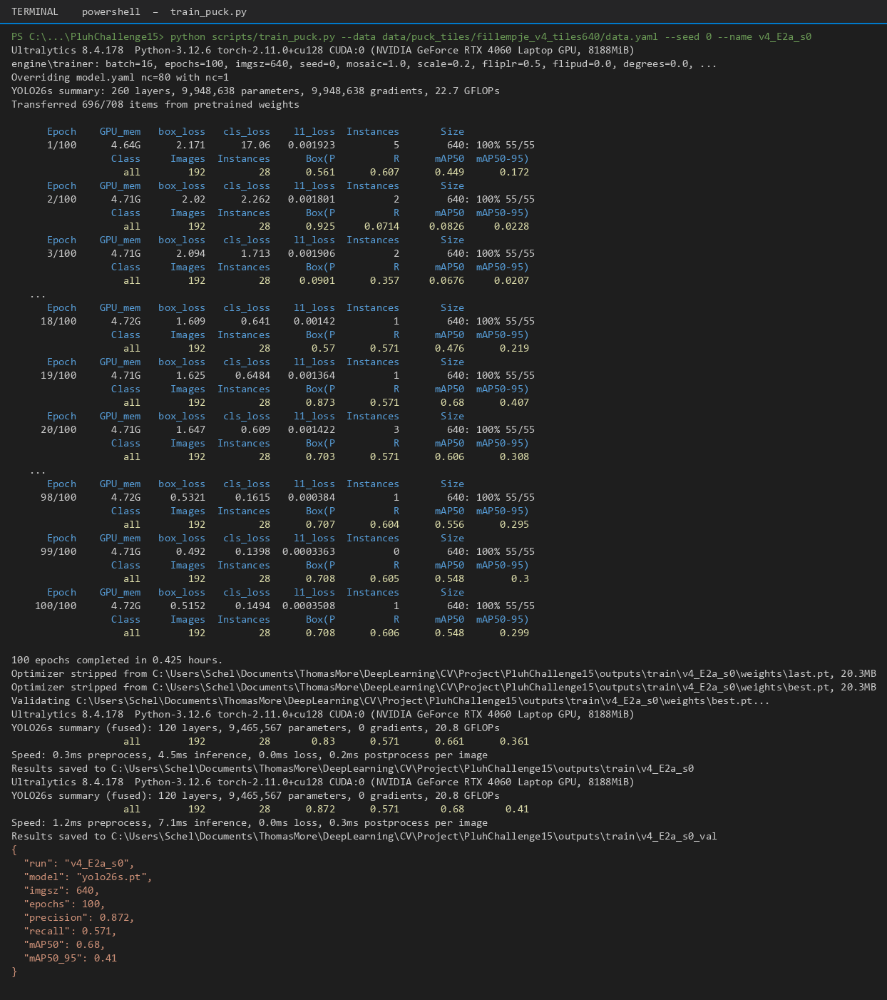

*The console output of a training run with the E2a recipe (here the v4 rerun with seed 0, RTX 4060
Laptop, 25 min). Rendered from the saved log `outputs/train_v4_s0.log`: progress-bar redraws are
removed and the middle epochs and the full argument list are left out ("..."); every number shown is
from the log. Note how noisy the val metrics are from epoch to epoch (epoch 19: mAP@50 0.68, epoch 20:
0.61) and how `best.pt` (epoch 19) is validated again at the end: 0.68 / 0.41.*

### 3.4 Training curves

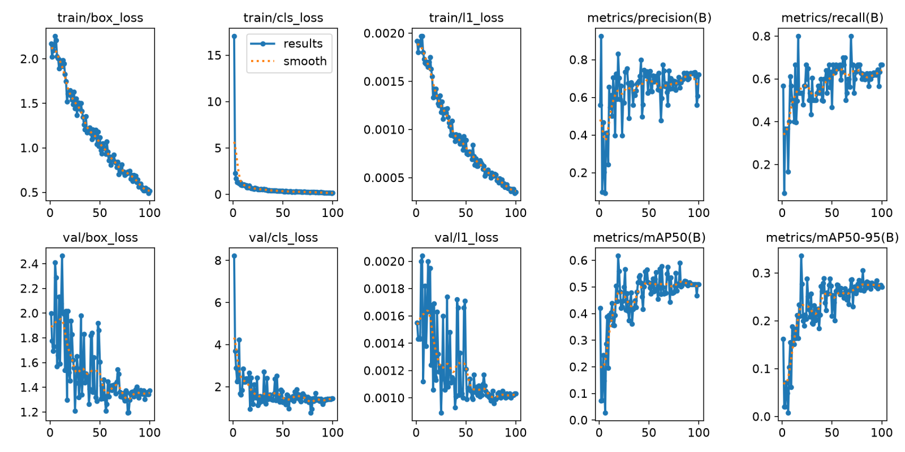

*E2a (`results.png`). YOLO26 has three losses: **box** (box position, IoU based), **cls** (puck or
background) and **l1** (box regression). The train losses keep falling for 100 epochs; the val losses
and val mAP flatten after about epoch 20–30. That is overfitting: with 31 training pucks the model
starts to memorise them. `best.pt` is from epoch 19.*

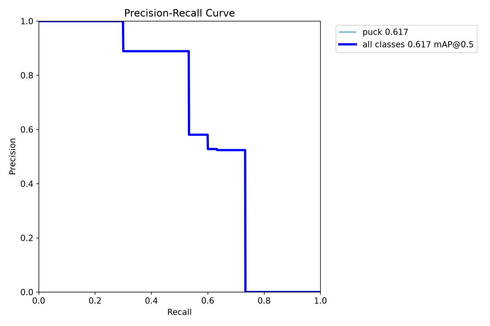 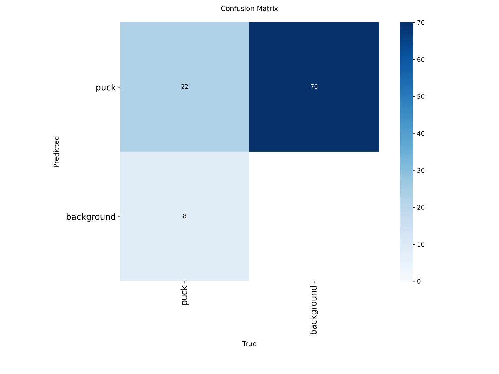

*Tile-level PR curve and confusion matrix of `best.pt` on the val tiles.*

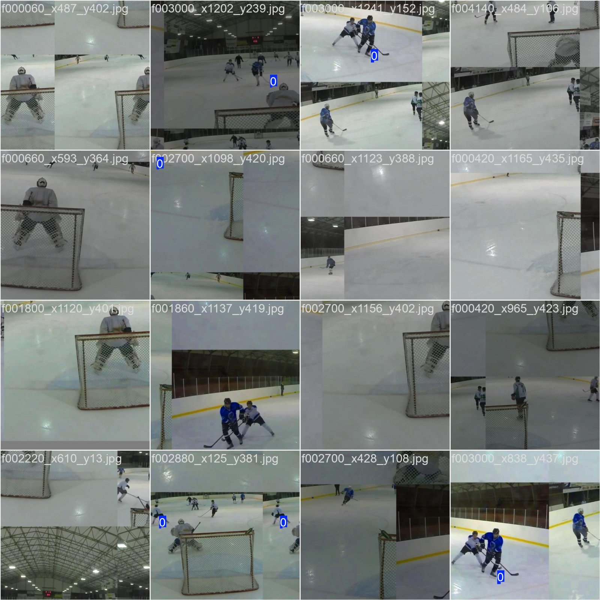

*A training batch: mosaic puts four tiles in one image; the puck boxes are tiny.*

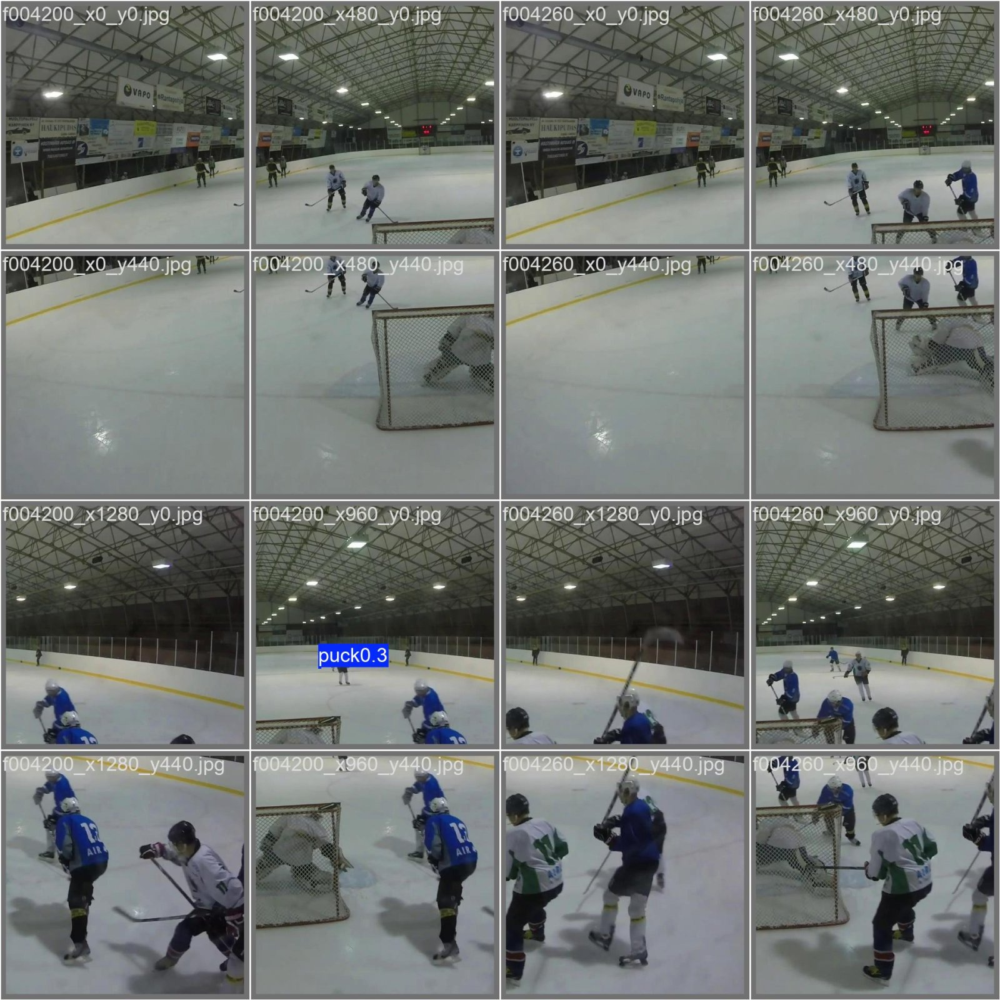

*Predictions on validation tiles.*

### 3.5 The experiments

| run | change | tile mAP@50 | tile mAP@50:95 | full frames TP / FP / FN | AP@50 full frame |
|---|---|---|---|---|---|
| baseline | COCO "sports ball", whole frame | – | – | 0 / 0 / 10 | 0.01 |
| E1 | 20 labelled frames (round 1) | 0.789* | 0.506* | 5 / 2 / 5 | 0.58 |
| **E2a** | 41 labelled frames (round 2) | **0.634** | **0.382** | **6 / 1 / 4** | **0.65** |
| E2b | E2a + hard negatives (skate crops, logo spot) | 0.460 | 0.269 | 7 / 11 / 3 | 0.55 |

\* on the old 4-frame val set, not comparable. All rows above are scored on v3 (10 val pucks).

**Re-scored on the final dataset v4** (f5070 removed, 9 val pucks; E3):

| model | tile mAP@50 | tile mAP@50:95 | full frames TP / FP / FN | AP@50 full frame |
|---|---|---|---|---|
| baseline | – | – | 0 / 0 / 9 | 0.02 |
| E1 | 0.522 | 0.346 | 5 / 2 / 4 | 0.64 |
| **E2a** | **0.680** | **0.410** | **6 / 1 / 3** | **0.72** |
| E2b | 0.497 | 0.290 | 7 / 11 / 2 | 0.61 |
| E2a recipe retrained on v4, 3 seeds | 0.586 ± 0.104 | 0.362 ± 0.057 | 6 / 1–2 / 3 | 0.665 ± 0.050 |

Retraining with seed 0 on the same GPU gave **exactly** the same model as the original E2a (best
epoch 19, identical metrics and clip detections): training is deterministic, so the run is fully
reproducible.

**Seed study (S1).** One run per variant on 10 val pucks proves little, so we trained the E2a recipe and
a clean hard-negative variant (E2c) with seeds 0, 1, 2:

| variant | tile mAP@50 | tile mAP@50:95 | recall (full frames) | AP@50 full frame |
|---|---|---|---|---|
| E2a | 0.56 ± 0.06 | 0.31 ± 0.01 | 0.60 ± 0.00 | 0.59 ± 0.02 |
| E2c (+ hard negatives) | 0.52 ± 0.03 | 0.30 ± 0.004 | 0.50 ± 0.10 | 0.53 ± 0.02 |

**What we learned**

1. **More labelled data helped most** (E1 → E2a): more precise, AP@50 0.58 → 0.65, and visibly fewer
   false alarms on the clip.
2. **The seed alone moves mAP@50 by ±0.05.** A difference under ~0.1 between two single runs means
   nothing here. Our logged 0.634 is the best of four draws; the honest figure is 0.56 ± 0.06.
3. **Hard negatives did not help**, even with the comparison made clean (S1). The main false positive is
   a stick blade next to a puck, which is a labelling question, not something extra background crops fix.
4. Recall on full frames is stable (6/10 in every E2a seed); what varies is the number of false alarms.

---

## 4. Error analysis

### 4.1 Threshold and NMS (P1)
Our pipeline has two NMS steps: inside each tile (Ultralytics) and between overlapping tiles (our merge).

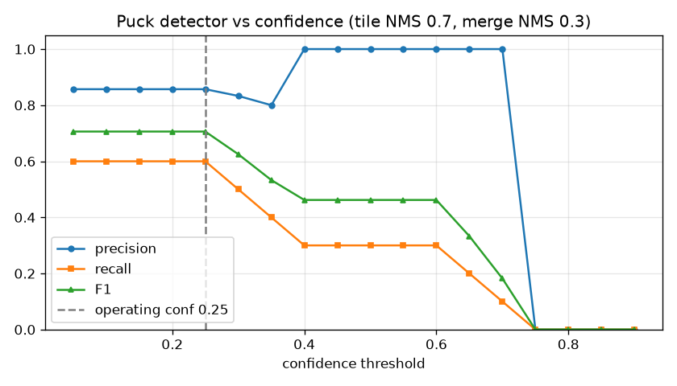

- **The merge NMS is essential:** without it AP@50 drops from 0.65 to 0.40, because the same puck is
  found by two overlapping tiles (11 duplicate false positives).
- **No threshold recovers the missed pucks:** results are identical from conf 0.05 to 0.25, so the 4
  missed pucks get no box at all. Raising conf to 0.40 removes the one false positive but also 3 of the
  6 hits. We keep conf 0.25 / tile NMS 0.7 / merge NMS 0.3, now justified by measurement.

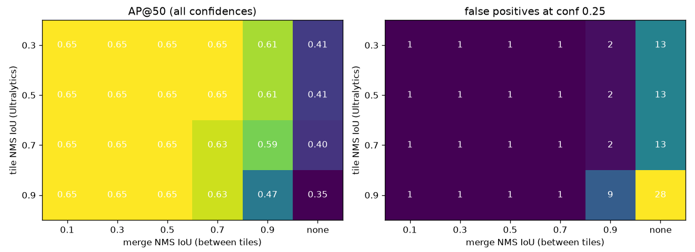

### 4.2 The five errors of E2a (checked by Zjef)

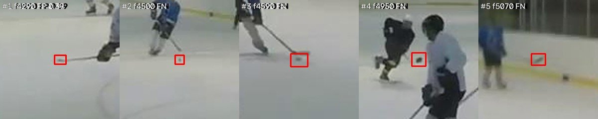

| frame | error | what it is | root cause |
|---|---|---|---|
| f4290 | false positive (conf 0.39) | toe of a stick blade | blade vs puck: the labels show dark spots at blades both as "puck" and "not puck" |
| f4590 | missed | puck touching the blade; the model has a box on it at conf 0.044 | same blade rule: the model learned "dark spot at a blade = usually not a puck" |
| f4500 | missed | ~6 px puck, motion-blurred | round-1 proposals only found sharp, compact pucks, so blurred pucks are rare in train |
| f4950 | missed | elongated object between two players | unclear (Zjef could not tell); crowded scene |
| f5070 | "missed" | **a stick blade labelled as puck** (label error) | one reviewer, blade-vs-puck is hard for people too; removed in Roboflow v4: recall becomes 6/9 for E2a, nothing else changes (E3) |

**Conclusion:** none of the errors is a threshold problem. All of them come from the data: the blade
rule, the bias of our proposal step, and one wrong label. This is why the blade rule was written down
and the consistency check was done (§2).

### 4.3 Hypotheses for the next step
1. Apply the written blade rule (v4) and retrain over 3 seeds → fewer blade false positives, f4590-like
   pucks found.
2. Label blurred/airborne pucks on purpose, or add blur augmentation → higher recall on fast pucks.
3. More labels in the far half of the rink; a finer detection head (P2, stride 4) as the architectural
   option.

---

## 5. Homography and minimap

**Lens correction.** The action camera bends straight lines, and a homography only maps straight lines
to straight lines. We use a one-parameter radial model and chose k1 = −0.125 by making the yellow kick
plates along both boards as straight as possible (plumb-line method, `calibrate_lens.py`, H4).

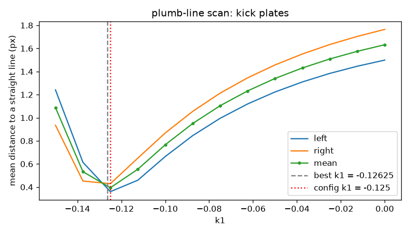

**Homography.** Six rink points with known IIHF positions: the two near faceoff dots, the two crease
corners on the goal line, and the bases of the two far goal posts, measured on the median background
(the empty rink). `cv2.findHomography` fits the 3×3 matrix (8 unknowns, so 4 points is the minimum; 6
gives a residual we can check).

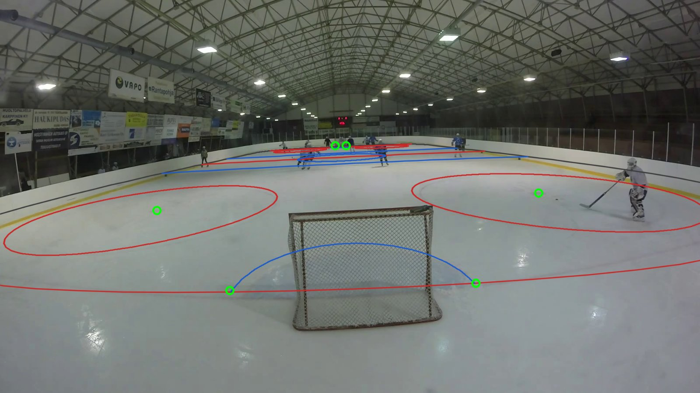

*The rink template projected back into the image with H3. Green circles = the 6 keypoints. The circles,
the goal line and the far lines were not all used in the fit; they line up, which is the real check.*

**Planar assumption.** Only points on the ice follow the homography, so a player is placed by the
bottom-centre of the box (the skates) and the puck by the bottom of its box, never by the box centre.

**Accuracy.** Residual 2.8–7.6 px per keypoint. Near the camera that is a few centimetres to decimetres;
at the far goal 5 px is 6–10 m, because the far half of the rink covers only ~30 image rows. No fit can
repair that; only a higher or second camera could.

---

## 6. Pipeline and app

`streamlit run app.py`. All heavy work lives in `scripts/` (`pipeline.py` per frame: detect → map →
draw), so the app runs the same code the experiments were logged with.

| tab | what it shows |
|---|---|
| Frame | any moment of the clip; change a parameter in the sidebar and see the effect at once |
| Clip | processes a time range into a side-by-side video (annotated frame + minimap) and a positions CSV |
| Tracking / Teams / Puck model / Homography | the logged results: gap test, heatmaps, metrics and examples, keypoints and overlay |

Sidebar: person model size and confidence, puck detector (fine-tuned / baseline / off) with confidence,
tile size and overlap, lens k1, camera motion, Kalman settings, team colours.

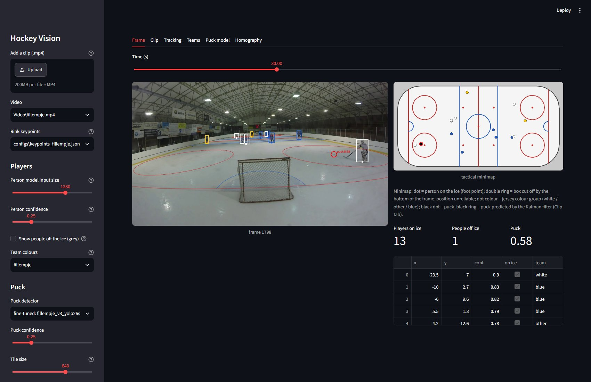

*Frame tab at 30 s: person boxes coloured by team (white / blue / yellow = "other"), the puck ring
with its confidence (0.58), the projected rink template on the video, and the minimap with every
player on the ice.*

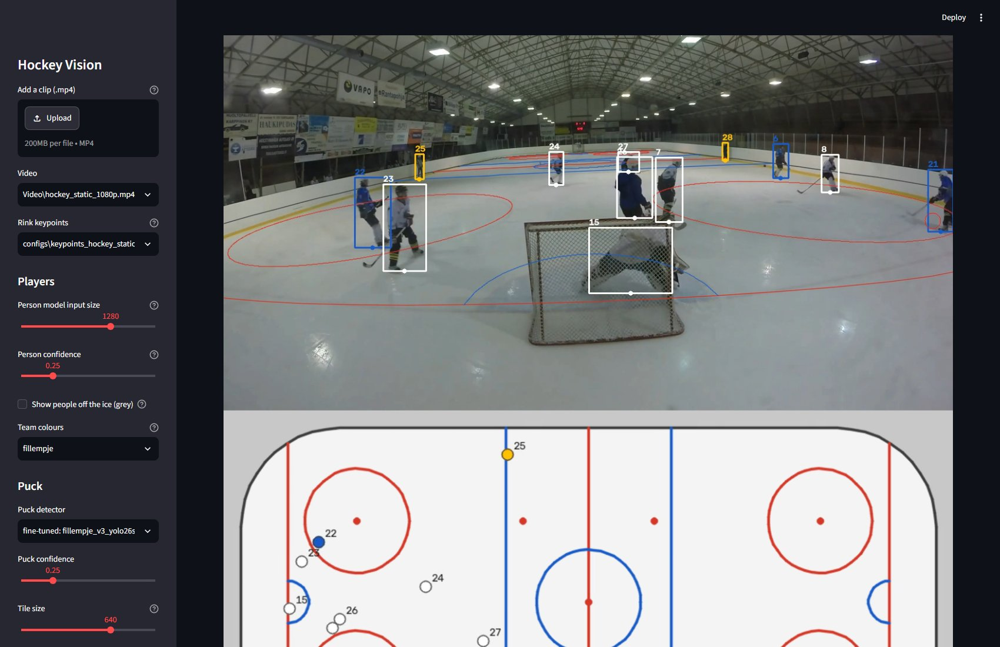

*Clip tab after processing 20–25 s with tracking on: ByteTrack IDs on the boxes and the same IDs on
the minimap below the video.*

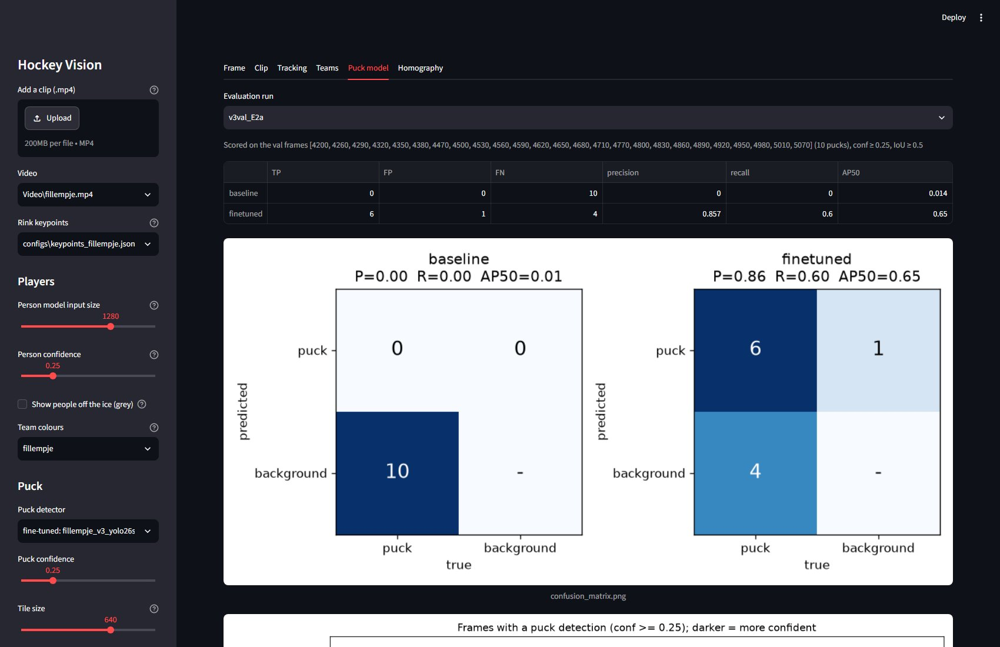

*Puck model tab: baseline vs fine-tuned on the val frames, with the confusion matrices.*

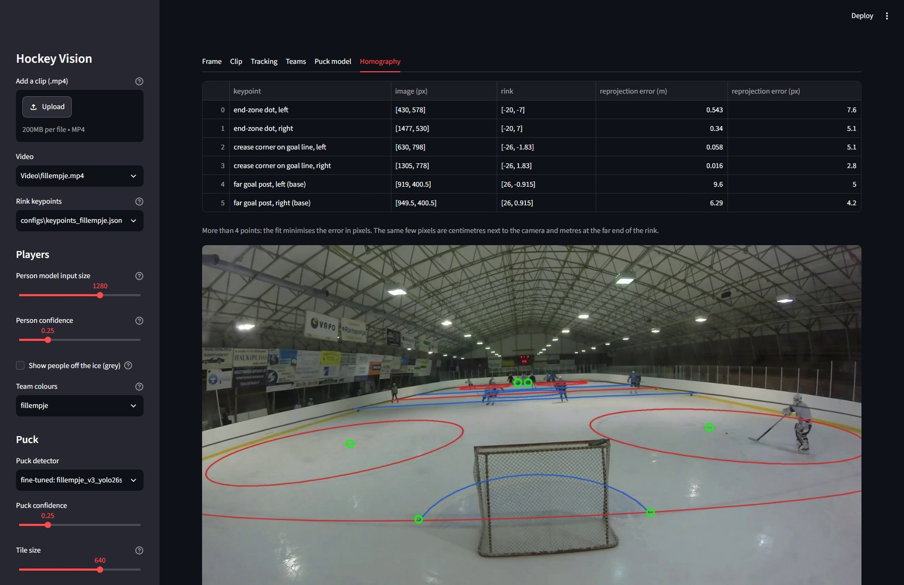

*Homography tab: the 6 keypoints with their reprojection error in metres and pixels.*

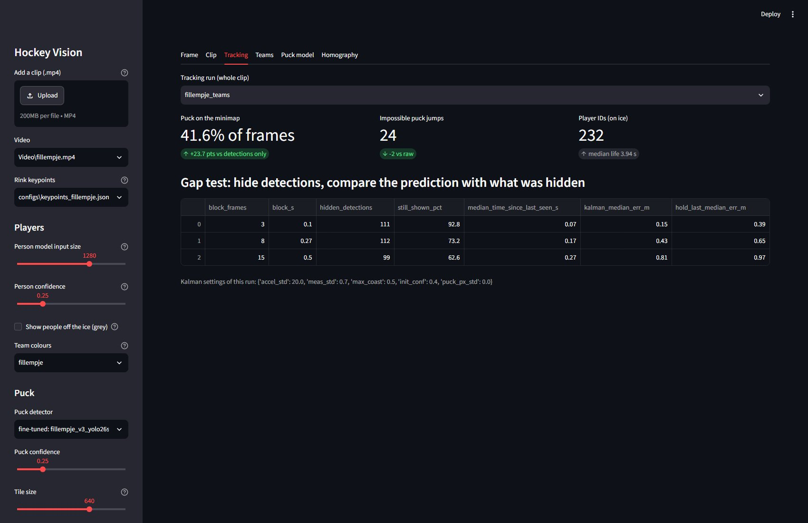

*Tracking tab: the whole-clip tracking run and the gap test. (On this PC the run gives 232 player IDs;
the log's 198 came from another GPU, see R1.)*

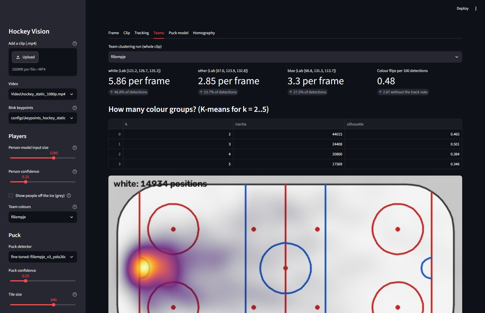

*Teams tab: the colour groups and the K-means selection.*

The app screenshots were taken by Claude Code with headless Chrome on the running app.

---

## 7. Extra Mile

### 7.1 Tracking (T1, T2)
- **Players:** ByteTrack (Ultralytics), with a tuned config (3 s buffer, stricter new-track threshold).
  Its second matching round uses low-confidence boxes, so a partly hidden player keeps the track.
- **Puck:** our own constant-velocity **Kalman filter on the rink in metres**, with a Mahalanobis gate
  (χ², 99%) and a rink limit (a predicted puck cannot leave the ice).

| | result |
|---|---|
| puck on the minimap | 17.9% of frames (detections) → **41.6%** with the filter |
| gap test (hide detections, compare) | 2.7× closer than "hold last position" for 0.1 s gaps; only 1.2× at 0.5 s |
| player IDs | ~200 IDs for ~14 people: tracks break after long occlusions, and kits look alike |

### 7.2 Team colours and heatmaps (TM1)
K-means (k = 3) on jersey colour in CIELAB (75th percentile of L, mean a and b, standardised), with a
vote over the last 30 detections of each track. It separates white team / blue team / bystanders at the
boards with **92%** per detection on a 115-crop sample labelled blind by Andreas (TM2). The vote over
the last 30 detections scores 90%: it does not raise the accuracy, but it gives 6× fewer colour flips on
the minimap, so the app keeps it. An earlier score of 95.5% rested on labels by Claude Code and was too
optimistic.

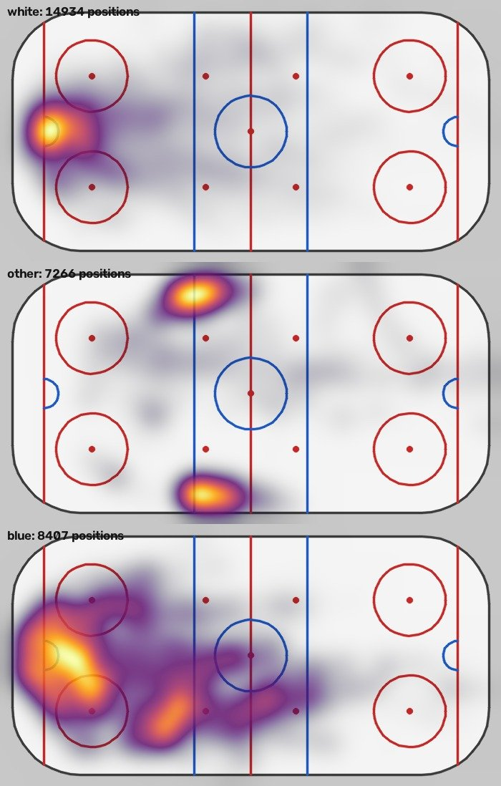

The first version clustered on brightness only (light / medium / dark): K-means uses Euclidean
distance and L had a 5× larger range than a/b. Standardising the features fixed it.

---

## 8. Problems along the way and our solutions

| problem | what we saw | solution |
|---|---|---|
| foundation-model auto-labelling failed | Gemini boxed the wrong spot, SAM 3 gave 6 "pucks" in one frame | own proposal step (background subtraction, later our own model) + human review of every label |
| first clip unsuitable | handheld 4K, camera moved, only ~12 frames with a findable puck | switched to a static camera clip (`hockey_static_1080p.mp4`) |
| puck too small for YOLO | 6–10 px becomes 2–3 px after resizing | training and inference on native-resolution 640 px tiles |
| duplicate puck boxes | the same puck found by two overlapping tiles | a second (merge) NMS step; measured as essential in P1 |
| lens distortion | board lines curved, homography inaccurate | radial lens model, k1 chosen by the plumb-line method (H2, made reproducible in H4) |
| homography wrong at the far end | the 4-point fit put the far goal at ~100 m instead of 26 m | 2 extra keypoints at the far goal and fitting the error in pixels instead of metres (H3) |
| homography had a negative scale | every point "behind the camera", template disappeared | normalise the sign so w > 0 |
| overfitting | train loss keeps falling, val mAP flat after ~20–30 epochs | `best.pt` on val; more labelled data was the real gain |
| hard negatives seemed harmful | E2b had 11 false positives | audit found the datasets differed in almost every tile; clean repeat over 3 seeds (S1): no benefit, no big harm |
| optimistic results in our own log | unfair Kalman gap test, confounded comparison | an audit of all code and numbers (A1); corrected entries instead of rewriting them |
| labellers disagree | 0/7 same puck between two labellers | written rules: 2 px margin, ±10 frames check, blade rule |
| a val label was wrong | f5070 was a stick blade | found in the error check (Zjef), removed in Roboflow, v4 generated and all models re-scored (E3) |

---

## 9. What went well, what went badly

**Went well**

- The tiling design turned the puck from almost never found (0/10) into found in 6/9 val frames with
  AP@50 0.72 (v4).
- Model-in-the-loop labelling sped up round 2, and human review kept wrong proposals out.
- Honest measurement: seeds, an audit, a fair gap test, and errors traced to the data.
- A working end-to-end app with two Extra Mile tracks.

**Went badly / limitations**

- The dataset is small (41 pucks) and biased towards easy pucks by our first proposal step.
- No test set picked without a model; every val number is somewhat optimistic.
- Agreement between labellers was low; the blade question took long to decide.
- One training recipe: augmentations, model size and tile size were justified but never varied.
- The far half of the rink is only mapped to several metres; player IDs break after occlusions.

**Next steps**

1. Roboflow v4, retrain over 3 seeds, re-evaluate: **done** (E3).
2. A model-free test set (e.g. every 30th frame of an unseen part, labelled by hand).
3. Small ablations of the recipe (e.g. scale augmentation, yolo26n vs s), each over 3 seeds.
4. Second consistency round with a third labeller.

---

## 10. GenAI use, ownership and reproduction

We used GenAI (Claude Code) to help write the code, to understand the assignment better, and to give
us ideas and options; the decisions were ours (sport and clip, which labels to keep, the labelling rules,
the Extra Mile tracks, the model we use). Big choices were made in team meetings with everyone present,
and the team members with a GPU ran and checked the code and results on their own PC.

Checking the AI paid off: only 65–74% of its "confident" puck proposals were real pucks, its first
homography put the far goal ~70 m too far, its first Kalman test was too optimistic, and a val label
(f5070) turned out to be a stick blade. Visual checks done only by the AI are marked as such in the log.
Every team member is expected to explain the whole project on the oral exam. Details per part:
[`genai.md`](genai.md).

**Team contributions.** The main choices and agreements (sport and clip, labelling rules, which Extra
Mile tracks, who does what) were made together in team meetings with everyone present. Besides that:

| member | main contributions |
|---|---|
| **Andreas** | all labelling in Roboflow: reviewed every AI proposal and drew, moved or rejected the boxes for both rounds, removed f5070 and generated v4; the blind check of the team-colour sample (115 players, TM2); the blade rule; the documentation (annotation rules, GenAI statement, this report), with Claude Code drafting |
| Finn | asked for the full audit (A1); decided the 2 px margin and the ±10 frames check after the consistency round |
| Mihai | the original baseline runs on his PC (E0); asked for the lens calibration (H4) |
| Zjef | the blind labelling round (consistency check); checked the five E2a errors and found that f5070 was a stick blade |

**Reproduce.** Every entry in `experiments.md` lists its exact command; setup is in the README.
Videos, datasets, weights and run outputs are not in git. Run folders and datasets still carry the clip's
working name `fillempje` (renamed to `hockey_static_1080p`), because the log refers to them.

---

## 11. Code overview

The code is in the GitHub repository (and the attached zip). Every script has a docstring with its goal,
outputs and an example command, and writes its results to `outputs/<step>/<run-name>/`.

| step in the pipeline | file | what it does |
|---|---|---|
| app | `app.py` | Streamlit dashboard: video next to the minimap, all parameters in the sidebar |
| app | `scripts/pipeline.py` | per frame: detect players and puck → map to the rink → draw |
| baseline | `scripts/baseline.py` | pretrained COCO YOLO on a clip (E0) |
| annotation | `scripts/extract_frames.py` | candidate frames at full resolution |
| annotation | `scripts/propose_puck.py`, `scripts/propose_model.py` | assisted labelling: puck proposals for Roboflow Review (round 1: background subtraction, round 2: our model) |
| annotation | `scripts/label_agreement.py`, `scripts/label_blind.py` | consistency check between two labellers |
| fine-tuning | `scripts/make_puck_dataset.py` | Roboflow export → 640 px tiles, split by time |
| fine-tuning | `scripts/train_puck.py` | fine-tune YOLO26s on the tiles, log mAP@50 / mAP@50:95 |
| evaluation | `scripts/eval_puck.py` | baseline vs fine-tuned on full frames (tiled inference, AP@50, confusion matrix) |
| evaluation | `scripts/seed_summary.py`, `scripts/sweep_conf_nms.py` | seed study; confidence and NMS sweep with every error as a crop |
| homography | `scripts/rink.py`, `scripts/homography.py`, `scripts/calibrate_lens.py` | rink template, lens correction + homography, choosing k1 |
| Extra Mile | `scripts/kalman.py`, `scripts/track.py` | Kalman filter for the puck, ByteTrack for players, gap test |
| Extra Mile | `scripts/teams.py`, `scripts/label_teams.py` | jersey colour clustering and occupancy heatmaps; blind labelling of the check sample |
| config | `configs/` | rink keypoints + lens model per clip, tuned ByteTrack settings |
| documentation | `docs/` | experiment log, annotation rules, error analysis, GenAI use, this report |

**Run it.** Install as in the README (PyTorch with CUDA first, then `requirements.txt`), put the clip in
`Video/` and start the app with `streamlit run app.py`.
